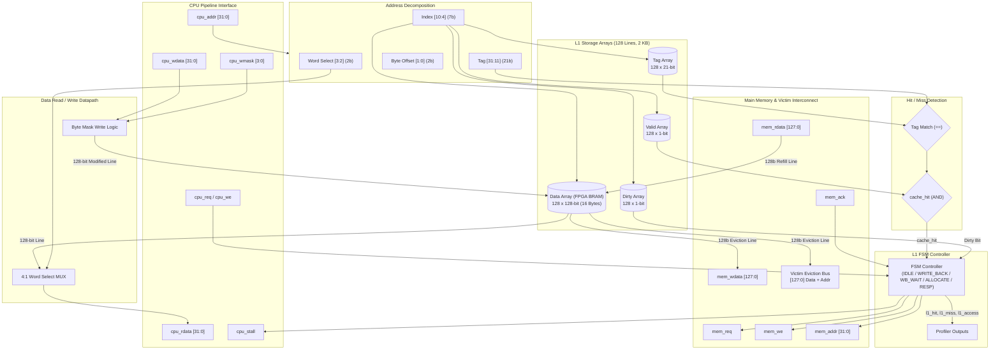

# Memory Hierarchy Enhancement of an RV32I Processor with Victim Cache and Stride Prefetching

**Group Number:** 14  
**Repository:** [https://github.com/Greninja-07/riscv-victim-cache](https://github.com/Greninja-07/riscv-victim-cache)

---

## Team Members & Responsibilities

| Member | Assigned Area | Focus Scope |
| :--- | :--- | :--- |
| **Abhishek Kumar** | **L1 Cache & Memory Subsystem** | Direct-Mapped L1 Cache Controller, BRAM instantiation, Memory interfacing |
| **Manas** | **RV32M & Pipeline Hazard Unit** | Multiplier/Divider datapath, RV32M execution logic, Unified Hazard Detection Unit |
| **Soham** | **Victim Cache Subsystem** | Fully associative Victim Cache, block swap logic, cache bypass routing |
| **Archit** | **Prefetcher & Profiling Hardware** | Stride Prefetcher FSM, performance counter profilers, FPGA 7-segment display I/O |

---

## Week 1 Milestone Deliverable (5 – 11 Oct)

### Direct-Mapped L1 Data Cache & Configurable Main Memory Model
Implemented by: **Abhishek Kumar**

### 1. Architectural Specifications
* **Cache Capacity:** 2 KB total data storage ($128 \text{ lines} \times 16 \text{ bytes/line}$).
* **Block Size:** 16 bytes (4 words $\times$ 32 bits = 128 bits per line).
* **Cache Organization:** Direct-Mapped (128 sets, 1 line per set).
* **Address Breakdown (32-bit):**
  * `Tag` [31:11]: 21 bits
  * `Index` [10:4]: 7 bits ($2^7 = 128$ lines)
  * `Word Select` [3:2]: 2 bits (4 words per block)
  * `Byte Offset` [1:0]: 2 bits (4 bytes per word)
* **Write Policy:** Write-Back with Write-Allocate.
* **FPGA Resource Style:** Synthesizable FPGA Block RAM inference (`(* ram_style = "block" *)`).
* **Hit Latency:** **Zero-stall hit** path for optimal pipeline throughput on both read hits and write hits.
* **Byte Strobing:** 4-bit byte-write mask (`cpu_wmask[3:0]`) supporting RISC-V `SB` (byte), `SH` (halfword), and `SW` (word) instructions.
* **Victim Cache Ready:** Dedicated 128-bit eviction interface (`victim_evict_valid`, `victim_evict_addr`, `victim_evict_data`) ready for Soham's Victim Cache integration in Week 4.

### 2. Architecture Block Diagram


---

### 3. Module Interfaces

#### `l1_cache_controller.v`
```verilog
module l1_cache_controller #(
    parameter DATA_WIDTH  = 32,
    parameter ADDR_WIDTH  = 32,
    parameter BLOCK_WORDS = 4,    // 16 bytes / line
    parameter BLOCK_BITS  = 4,
    parameter INDEX_BITS  = 7     // 128 lines (2 KB)
)(
    input  wire                   clk,
    input  wire                   rst,

    // CPU Pipeline Interface
    input  wire                   cpu_req,
    input  wire                   cpu_we,
    input  wire [ADDR_WIDTH-1:0]  cpu_addr,
    input  wire [DATA_WIDTH-1:0]  cpu_wdata,
    input  wire [3:0]             cpu_wmask,
    output reg  [DATA_WIDTH-1:0]  cpu_rdata,
    output reg                    cpu_stall,

    // Hardware Profiler Interface (Archit)
    output wire                   l1_access,
    output wire                   l1_hit,
    output wire                   l1_miss,

    // Main Memory Interconnect
    output reg                    mem_req,
    output reg                    mem_we,
    output reg  [ADDR_WIDTH-1:0]  mem_addr,
    output reg  [127:0]           mem_wdata,
    input  wire [127:0]           mem_rdata,
    input  wire                   mem_ack,

    // Victim Cache Eviction Bus (Soham)
    output reg                    victim_evict_valid,
    output reg  [ADDR_WIDTH-1:0]  victim_evict_addr,
    output reg  [127:0]           victim_evict_data
);
```

#### `main_memory.v`
Configurable latency memory model simulating DRAM / off-chip latency:
* **Board Switch Selectable Latency (`latency_sel [1:0]`):**
  * `2'b00` : **$N = 1$ cycle** (Baseline reference: reproduces zero-cache-benefit baseline)
  * `2'b01` : **$N = 5$ cycles** (Moderate latency)
  * `2'b10` : **$N = 10$ cycles** (Default off-chip latency)
  * `2'b11` : **$N = 20$ cycles** (High penalty latency)
* 128-bit wide block transfers (matching L1 cache line).
* Edge-safe Request/Acknowledge handshake.

---

### 4. Verification & Testbench Results

The self-checking testbench (`tb_l1_cache.v`) rigorously tests all cache operations against `main_memory.v`:

1. **Test 1: Cold Read Miss:** Verifies miss detection, asserts `mem_req`, stalls CPU for memory latency ($N=10$), refills 128-bit block, and releases CPU stall.
2. **Test 2: Spatial Locality Hits:** Verifies consecutive reads to Words 1, 2, and 3 in the same 16-byte block complete with **0 stall cycles**.
3. **Test 3: Write Hit & Byte Masking:** Verifies full word store (`SW`) and individual byte store (`SB`) with byte mask merging and dirty bit tracking.
4. **Test 4: Write Miss (Store Allocate):** Verifies miss allocation, merging write data into fetched line, and setting dirty flag.
5. **Test 5: Conflict Miss & Dirty Eviction Writeback:** Forces tag collision on Index 0, writes dirty block back to main memory, asserts `victim_evict_valid`, and allocates new line.
6. **Test 6: Memory Persistence Reload:** Reloads previously evicted block from main memory and verifies all earlier byte and word modifications remained persistent.
7. **Test 7: Configurable Latency Switches (TA Requirement):** Dynamically toggles `latency_sel` across $N = 1, 5, 20$ cycles to verify penalty scaling and baseline reference.

#### Simulation Command:
```bash
# Compile and run with Icarus Verilog
iverilog -o sim_l1 l1_cache_controller.v main_memory.v tb_l1_cache.v
vvp sim_l1

# View waveforms in GTKWave
gtkwave waveform.vcd
```

#### Simulation Output:
```
==================================================================
  STARTING L1 CACHE CONTROLLER UNIT TESTBENCH (Group 14)
  Author: Abhishek Kumar | Configuration: 2 KB, 16B Line, N=10
==================================================================

--- TEST 1: Cold Read Miss ---
[PASS] Read Addr: 0x00000000 | Data: 0xcafe0000 | Stall Cycles: 12

--- TEST 2: Multi-Word Spatial Locality Hits (Same 16B Line) ---
[PASS] Read Addr: 0x00000004 | Data: 0xcafe0001 | Stall Cycles: 0
[PASS] Read Addr: 0x00000008 | Data: 0xcafe0002 | Stall Cycles: 0
[PASS] Read Addr: 0x0000000c | Data: 0xcafe0003 | Stall Cycles: 0

--- TEST 3: Write Hit with Byte Masking & Dirty Tracking ---
[INFO] Write Addr: 0x00000000 | Data: 0xaabbccdd | Mask: 1111 | Stall Cycles: 0
[PASS] Read Addr: 0x00000000 | Data: 0xaabbccdd | Stall Cycles: 0
[INFO] Write Addr: 0x00000004 | Data: 0x00009900 | Mask: 0010 | Stall Cycles: 0
[PASS] Read Addr: 0x00000004 | Data: 0xcafe9901 | Stall Cycles: 0

--- TEST 4: Write Miss (Store Allocate) on Block 1 ---
[INFO] Write Addr: 0x00000010 | Data: 0x12345678 | Mask: 1111 | Stall Cycles: 12
[PASS] Read Addr: 0x00000010 | Data: 0x12345678 | Stall Cycles: 0
[PASS] Read Addr: 0x00000014 | Data: 0xbeef0001 | Stall Cycles: 0

--- TEST 5: Conflict Miss & Dirty Write-Back ---
[PASS] Read Addr: 0x00000800 | Data: 0x44440800 | Stall Cycles: 24

--- TEST 6: Memory Persistence (Reload Evicted Block) ---
[PASS] Read Addr: 0x00000000 | Data: 0xaabbccdd | Stall Cycles: 12
[PASS] Read Addr: 0x00000004 | Data: 0xcafe9901 | Stall Cycles: 0

--- TEST 7: Configurable Latency Switches (TA Requirement) ---
[SWITCH] latency_sel = 2'b00 (N = 1 cycle baseline)
[PASS] Read Addr: 0x00000020 | Data: 0x44440020 | Stall Cycles: 3
[SWITCH] latency_sel = 2'b01 (N = 5 cycles)
[PASS] Read Addr: 0x00000030 | Data: 0x44440030 | Stall Cycles: 7
[SWITCH] latency_sel = 2'b11 (N = 20 cycles)
[PASS] Read Addr: 0x00000040 | Data: 0x44440040 | Stall Cycles: 22

==================================================================
  TESTBENCH COMPLETED
  TOTAL TESTS PASSED: 14
  TOTAL TESTS FAILED: 0
  STATUS: ALL TESTS PASSED SUCCESSFULLY! (Week 1 Deliverable Complete)
==================================================================
```

---

## Next Week Handoff (Week 2: 12 – 18 Oct)
* **Integration with Manas:** `l1_cache_controller.v` will interface with the `dmem_*` signals in `pipeline.v`. `cpu_stall` will connect to Manas's Unified Hazard Detection Unit to stall the RV32I pipeline during cache misses.